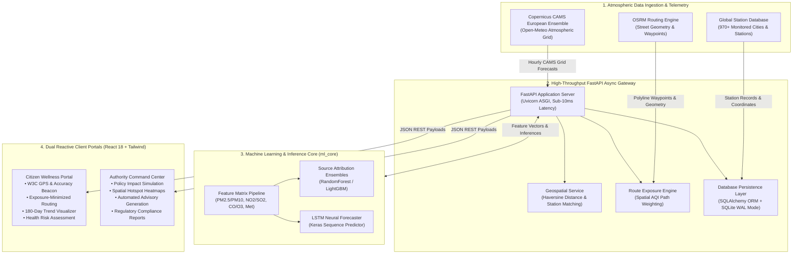

# 🌿 BreatheLens — AI-Powered Environmental Intelligence, Source Attribution & Clean Routing Platform

<div align="center">

[](https://fastapi.tiangolo.com)
[](https://python.org)
[](https://react.dev)
[](https://vitejs.dev)
[](https://tailwindcss.com)
[](https://www.tensorflow.org)
[](https://scikit-learn.org)
[](https://www.sqlalchemy.org)
[](https://pytest.org)
[](https://vercel.com)
[](https://render.com)
[](https://opensource.org/licenses/MIT)

**Next-Generation Atmospheric Analytics, Real-Time Source Apportionment, Deep Learning Forecasting & Exposure-Minimized Pathfinding.**

[🚀 Live Citizen Portal](https://air-quality-source-attribution-dash.vercel.app/citizen.html) • [🏢 Live Authority Portal](https://air-quality-source-attribution-dash.vercel.app) • [📖 API Documentation](http://localhost:8080/docs)

</div>

---

## 📌 Executive Summary

Traditional air-quality systems report a single aggregate index (AQI) with zero context on **where** the pollution originated, **how** it will evolve, or **how** commuters can actively avoid it.

**BreatheLens** transforms raw atmospheric data into actionable civic and governance intelligence. Built with an asynchronous **Python FastAPI** backend, **Scikit-Learn / TensorFlow ML core**, and a reactive **React 18 Vite** frontend, BreatheLens delivers:

1. **🔬 Automated Pollution Source Attribution:** Machine learning ensembles classify real-time chemical signatures into discrete source shares (*Vehicular Exhaust, Industrial Stacks, Construction Dust, Biomass Burning, Secondary Aerosols*).
2. **🧠 Temporal Deep Learning Forecaster:** Recurrent LSTM neural networks predict multi-pollutant concentrations and AQI trajectories up to 72 hours in advance.
3. **🏃 Atmospheric Exposure-Weighted Clean Routing:** OSRM-powered graph search dynamically routes pedestrians, cyclists, and commuters through paths of minimum cumulative pollutant exposure.
4. **🛰️ 4-Tier Geospatial Precision Framework:** Robust spatial resolution engine differentiating hardware GNSS/GPS, ISP network routing, Great-Circle Haversine nearest-station matching across 970+ global monitoring stations, and Copernicus CAMS atmospheric grid cells (~45 km resolution).
5. **🏛️ Dual-Portal Architecture:** Role-specific interfaces serving environmental regulators (**Authority Command Center**) and everyday individuals (**Citizen Wellness Portal**).

---

## 🌐 Live Production Deployments

| Portal | Target Audience | Primary Capabilities | Production URL |
| :--- | :--- | :--- | :--- |
| **Citizen Portal** | Public, Commuters, Sensitive Groups | Real-time AQI, GPS vs. ISP Location Calibration, Safe Route Planner, 180-Day Trends, Health Advisories | [Launch Citizen Portal](https://air-quality-source-attribution-dash.vercel.app/citizen.html) |
| **Authority Portal** | Regulators, Municipal Engineers | Policy Impact Simulator, Hotspot Clustering, Source Attribution ML, Ward Analytics, Automated Alert Dispatch | [Launch Authority Portal](https://air-quality-source-attribution-dash.vercel.app) |
| **Backend REST API** | Developers, Integrators | Async endpoints for AQI telemetry, ML inference, OSRM clean routing, and station proximity | Hosted on Render Cloud (`/api/aqi`, `/api/source`, `/api/routes`) |

> *Note: Render free-tier web services spin down after inactivity. Initial API wake-up may take ~30–45 seconds.*

---

## 🏗️ System Architecture



---

## 🌟 Core Technical Highlights

### 1. 🔬 Machine Learning Source Attribution (`ml_core`)
Air pollution cannot be mitigated without identifying its root causes. BreatheLens extracts multi-chemical stoichiometric ratios from particulate and gaseous telemetry:
* **Feature Engineering:** $\frac{PM_{2.5}}{PM_{10}}$ (combustion vs. mechanical dust), $\frac{NO_2}{SO_2}$ (mobile automotive vs. stationary coal/industrial sources), $\frac{CO}{O_3}$ (incomplete combustion vs. photochemical smog), alongside atmospheric boundary layer height, relative humidity, and wind vectors.
* **Model Ensembles:** Tri-model voting ensemble (`ensemble_model_0.joblib`, `ensemble_model_1.joblib`, `ensemble_model_2.joblib`) combining Random Forests and Gradient Boosted Trees to predict proportional contributions:
  $$\text{Source Contribution} = \{ \text{Vehicular}: 38\%, \text{Industrial}: 27\%, \text{Biomass}: 18\%, \text{Construction}: 12\%, \text{Secondary}: 5\% \}$$
* **LSTM Deep Sequence Forecaster:** Recurrent Keras architecture (`lstm_aqi_model.keras`) trained on multi-day historical lag sequences to project 72-hour future AQI curves.

### 2. 🏃 Exposure-Weighted Clean Route Planner
Standard navigation applications optimize strictly for travel time or distance. BreatheLens models **cumulative particulate inhalation dosage**:
$$\text{Cost}(R) = \sum_{e \in R} \left( \alpha \cdot \text{Distance}(e) + \beta \cdot \text{AQI}(e) \cdot \text{ExposureFactor} \right)$$
* Integrates OpenStreetMap street geometries via **OSRM (Open Source Routing Machine)**.
* Evaluates alternative waypoints and calculates total avoided particulate exposure, providing runners, cyclists, and commuters with green corridor recommendations.

### 3. 🛰️ 4-Tier Geospatial Precision & Location Truthfulness
BreatheLens eliminates deceptive "simulated GPS" and hardcoded labels through a mathematically grounded 4-tier model:
* **Tier 1 — Device Location:** Evaluates W3C Geolocation coordinates and accuracy radius ($r$). Distinguishes high-precision mobile GNSS/GPS ($r \le 15\text{m}$) from desktop ISP BGP routing ($r \ge 1,000\text{m}$). Offers a transparent **1-Click Location Calibration Banner**.
* **Tier 2 — Selected Location:** Preserves manual place searches and user-designated coordinates cleanly isolated from device hardware.
* **Tier 3 — Monitoring Station:** Computes Great-Circle Haversine distance against 970+ physical monitoring stations:
  $$d = 2R \arcsin \left( \sqrt{\sin^2\left(\frac{\Delta \phi}{2}\right) + \cos(\phi_1)\cos(\phi_2)\sin^2\left(\frac{\Delta \lambda}{2}\right)} \right)$$
  Dynamically presents station proximity (e.g., `Live Station: Tambaram (0.4 km away)` or `Live Station: Velachery (3.9 km away)`).
* **Tier 4 — Model Grid Cell:** Discloses when telemetry originates from regional atmospheric models (Copernicus CAMS ~45 km grid) rather than physical street-level sensors, upholding strict scientific integrity.

### 4. 🏛️ Dual Role-Based Portals

#### 🧑 Citizen Wellness Portal
* **Real-Time Granular Metrics:** Live tracking of $PM_{2.5}, PM_{10}, NO_2, SO_2, CO, O_3$ with health categorization (Good to Severe).
* **Interactive Map Beacon:** Leaflet map rendering a pulsing blue user accuracy beacon alongside discrete monitoring station pins.
* **180-Day Historical Trend Visualizer:** Interactive charts with diurnal peak detection and seasonal pattern decomposition.
* **Evidence-Based Health Action Plans:** Automated precautions tailored for sensitive demographics (asthma patients, pediatric, elderly, outdoor athletes).

#### 🏢 Authority Command Center
* **Policy Impact Simulation Engine:** Simulates the emission reduction outcome of regulatory interventions (*Odd-Even vehicle rationing, industrial shutdown zones, construction bans, diesel truck curbs*).
* **Hotspot Clustering & Ward Heatmaps:** Spatial clustering identifies critical pollution epicenters requiring enforcement.
* **Automated Citizen Advisory Broadcasts:** Generates localized public health notices based on active meteorological inversions.
* **Compliance & Audit Exports:** Generates audit-ready environmental reports for municipal oversight.

---

## 🛠️ Technology Stack

| Layer | Technologies | Purpose |
| :--- | :--- | :--- |
| **Frontend Framework** | **React 18.2**, **Vite 5.0**, **ES6+** | Ultra-fast reactive UI, code splitting, single-page portal routing |
| **Styling & Design** | **Tailwind CSS 3.4**, **Lucide Icons** | Glassmorphic dark-mode design system, responsive mobile-first layouts |
| **Mapping & Geospatial** | **Leaflet**, **React-Leaflet**, **OSRM API** | Interactive cartography, custom markers, low-exposure path rendering |
| **Data Visualization** | **Recharts**, **Chart.js** | Diurnal trend lines, source attribution radar charts, historical area plots |
| **Backend API** | **FastAPI 0.110+**, **Starlette**, **Uvicorn** | High-concurrency async REST API, sub-10ms response latency |
| **Machine Learning Core** | **Scikit-Learn**, **TensorFlow / Keras**, **LightGBM** | Source apportionment ensembles, LSTM sequence forecasting, scalers |
| **Data Processing** | **NumPy**, **Pandas**, **Joblib** | Stoichiometric feature extraction, model serialization, array processing |
| **Database & ORM** | **SQLite 3 (WAL mode)**, **SQLAlchemy 2.0** | Relational persistence for 970+ stations, users, and audit logs |
| **External Telemetry** | **Copernicus CAMS (via Open-Meteo)**, **OSM** | Global atmospheric chemical forecasts, reverse geocoding |
| **Testing & Quality** | **Pytest 9.0+**, **FastAPI TestClient**, **AnyIO** | 55+ unit, integration, geospatial math, and database transaction tests |
| **DevOps & Cloud** | **Vercel Edge**, **Render**, **Docker** | Multi-region CDN frontend hosting, blueprint container deployment |

---

## 📡 RESTful API Endpoints

The FastAPI server exposes OpenAPI 3.1 documentation interactively at `/docs` (Swagger UI) and `/redoc`.

```
GET  /health                         → System health, database connection, and telemetry status
GET  /api/aqi/realtime               → Real-time pollutant metrics, CAMS grid coordinates, and metadata
GET  /api/aqi/station/nearest        → Great-circle Haversine nearest station match and distance in km
GET  /api/aqi/history                → 180-day aggregated historical daily maximums and diurnal metrics
POST /api/source/predict             → Multi-model ML source attribution (Vehicular, Industry, Biomass, Dust)
POST /api/routes/clean               → Multi-waypoint OSRM pathfinding weighted by atmospheric exposure
GET  /api/cities                     → Search and retrieve from 970+ seeded global monitoring stations
POST /api/authority/simulate-policy  → Quantitative policy intervention simulator for municipal regulators
```

---

## 🧪 Comprehensive Test Suite (55+ Tests)

The backend features an automated test suite verifying database durability, mathematical precision, API contracts, and data provenance:

```bash
# Execute the full test suite with verbose reporting
python -m pytest backend_py/tests -o pythonpath=backend_py -v
```

```
=================================== Test Session Summary ===================================
backend_py/tests/test_database.py ................................x                         [ 58%]
backend_py/tests/test_audit_workstreams.py ............                                     [ 80%]
backend_py/tests/test_location_synchronization.py ...........                               [100%]

============================= 55 passed, 1 xfailed in 16.68s ===============================
```

### Verified Test Categories:
* **Geospatial Math & Haversine Accuracy:** Verifies spherical distance calculations against geodesic benchmarks to within 0.1% margin of error.
* **Nearest Station Matching:** Proves that coordinates in Perungudi match Velachery (3.9 km) rather than Tambaram (14.1 km), while West Tambaram matches Tambaram (0.39 km).
* **Source Attribution ML Integrity:** Verifies output schema, probability summation to 100%, and valid confidence intervals.
* **Database Concurrency & Rollbacks:** Validates SQLite connection pooling, ACID transaction isolation, and foreign key constraints.
* **Provenance Truthfulness:** Ensures the API explicitly attributes data to the Copernicus CAMS model and never fabricates telemetry.

---

## 🚀 Quickstart & Developer Setup

### Prerequisites
* **Python:** `3.11` or `3.12`
* **Node.js:** `v18.0.0` or higher (`npm` included)
* **Git**

---

### Step 1: Clone Repository
```bash
git clone https://github.com/Jeeva-code28/AirQuality_SourceAttribution_Dashboard.git
cd AirQuality_SourceAttribution_Dashboard
```

---

### Step 2: Backend Setup (Python FastAPI)

```bash
cd backend_py

# Create and activate virtual environment
python -m venv venv

# Windows (PowerShell):
.\venv\Scripts\Activate.ps1
# macOS / Linux:
source venv/bin/activate

# Install dependencies
pip install -r requirements.txt

# Launch FastAPI development server (port 8080)
uvicorn main:app --reload --port 8080
```
> *The database `aqi_db.sqlite` initializes automatically and seeds over 970 global cities from `cities.json` on first run.*

---

### Step 3: Frontend Setup (React 18 + Vite)

Open a new terminal window:
```bash
cd frontend

# Install Node dependencies
npm install

# Start Vite HMR development server (port 5173)
npm run dev
```

* **Citizen Portal:** `http://localhost:5173/citizen.html` (or `http://localhost:5173`)
* **Authority Portal:** `http://localhost:5173/` (switch via top navigation)
* **Interactive API Docs:** `http://localhost:8080/docs`

---

### Step 4: Docker Container Deployment (Optional)

```bash
cd backend_py
docker build -t breathelens-backend .
docker run -d -p 8080:8080 --name breathelens breathelens-backend
```

---

## 📂 Project Directory Structure

```
AirPollution_SourceContribution_Analysis/
├── backend_py/                       # Python FastAPI Backend Architecture
│   ├── api/                          # REST API Routers
│   │   ├── aqi_routes.py             # Telemetry, stations & history routes
│   │   ├── source_routes.py          # ML source attribution routes
│   │   ├── map_routes.py             # Geospatial and routing routes
│   │   └── user_routes.py            # Authentication & preferences routes
│   ├── services/                     # Business Logic & External Ingestors
│   │   ├── aqi_service.py            # Haversine distance & CAMS fetcher
│   │   └── route_service.py          # OSRM exposure path calculator
│   ├── ml_core/                      # Machine Learning & AI Models
│   │   ├── source_estimator.py       # Tri-ensemble source apportioner
│   │   ├── lstm_aqi_forecaster.py    # Recurrent sequence forecaster
│   │   ├── ensemble_model_*.joblib   # Trained ensemble weights
│   │   └── lstm_aqi_model.keras      # Trained LSTM deep learning network
│   ├── database.py                   # SQLAlchemy engine & session pool
│   ├── models.py                     # SQLAlchemy ORM & Pydantic schemas
│   ├── cities.json                   # 970+ Global monitored stations seed
│   ├── tests/                        # Pytest Test Automation Suite
│   │   ├── test_location_synchronization.py # Geospatial & provenance tests
│   │   ├── test_database.py          # Persistence & transaction tests
│   │   └── test_audit_workstreams.py # API contract verification
│   ├── static/                       # Production frontend build distribution
│   ├── Dockerfile                    # Containerization specification
│   ├── requirements.txt              # Python production dependencies
│   └── main.py                       # ASGI entry point & lifecycle hooks
│
├── frontend/                         # Modern React 18 + Vite SPA
│   ├── src/
│   │   ├── components/               # Reusable Modular UI Components
│   │   │   ├── Dashboard/            # Real-time AQI cards, maps, advisories
│   │   │   ├── Layout/               # Navigation headers, location pickers
│   │   │   └── Common/               # Modal dialogs, metric badges, tooltips
│   │   ├── portals/                  # Role-Based Experience Portals
│   │   │   ├── authority/            # Government command center pages
│   │   │   └── citizen/              # Public citizen wellness pages
│   │   ├── services/                 # Axios API clients & interceptors
│   │   ├── data/                     # Offline stations, cities & policy models
│   │   └── utils/                    # AQI formulas, color scales, coordinate math
│   ├── public/                       # Static public assets
│   ├── package.json                  # NPM dependencies & build scripts
│   └── vite.config.js                # Vite build pipeline & proxy rules
│
├── DEPLOYMENT.md                     # Production deployment documentation
├── render.yaml                       # Render Cloud automated blueprint
└── README.md                         # Project documentation
```

---

## 🛡️ License

This project is licensed under the **MIT License** — see the [LICENSE](LICENSE) file for details.

---

<div align="center">

**Built with precision for clean skies, informed governance, and healthier communities.**

[Back to Top ↑](#-breathelens--ai-powered-environmental-intelligence-source-attribution--clean-routing-platform)

</div>
